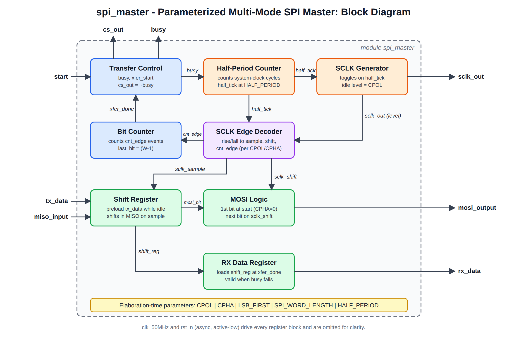
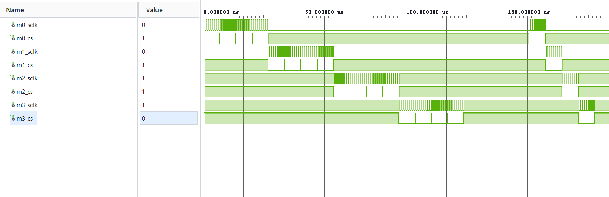
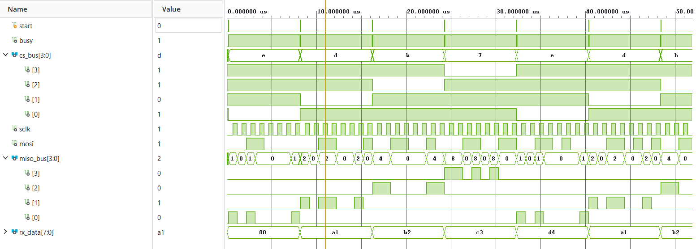
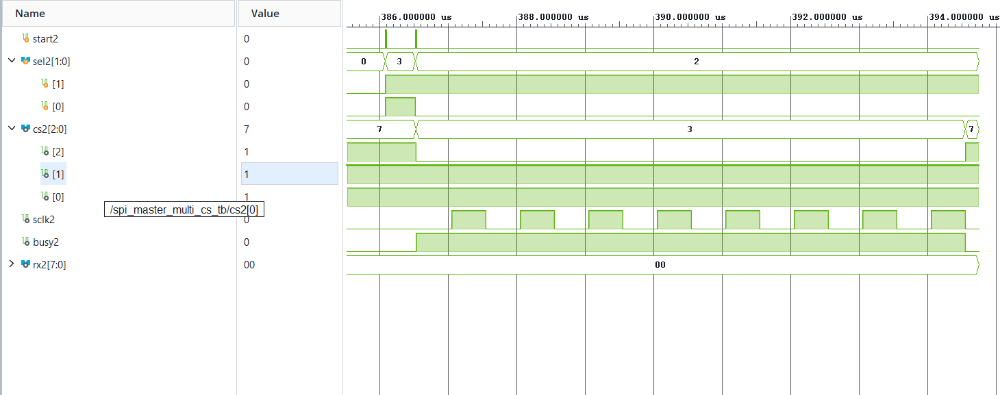
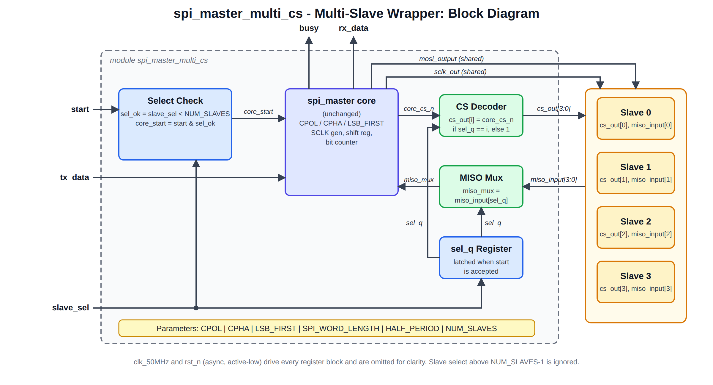

# Parameterized Multi-Mode SPI Master Controller in Verilog with Self-Checking Verification

A synthesizable SPI master written in Verilog-2001 that supports all four SPI modes (0-3)
and both bit orders (MSB-first / LSB-first). The mode and word length are selected by
parameters, and the design is verified with a self-checking testbench that runs five
configurations of the same RTL side by side.

## Features

* SPI modes 0, 1, 2, 3 selected with `CPOL` / `CPHA` parameters
* MSB-first or LSB-first transfers (`LSB_FIRST`)
* Configurable word length (`SPI_WORD_LENGTH`, default 8)
* Configurable SCLK frequency (`HALF_PERIOD`)
* Automatic active-low chip select (`cs_out`) and `busy` status flag
* Multi-slave support through a separate wrapper, `spi_master_multi_cs` (the core is unchanged)
* Asynchronous active-low reset; `start` is ignored while a transfer is in progress
* Self-checking testbench (no manual waveform inspection needed to know pass/fail)

## SPI modes

|Mode|CPOL|CPHA|SCLK idle|Sample edge|Shift edge|
|-|-|-|-|-|-|
|0|0|0|Low|Rising|Falling|
|1|0|1|Low|Falling|Rising|
|2|1|0|High|Falling|Rising|
|3|1|1|High|Rising|Falling|

## Parameters

|Parameter|Default|Description|
|-|-|-|
|`CPOL`|0|Clock polarity (SCLK idle level)|
|`CPHA`|0|Clock phase|
|`LSB_FIRST`|0|0 = MSB first, 1 = LSB first|
|`SPI_WORD_LENGTH`|8|Bits per transfer|
|`HALF_PERIOD`|25|System-clock cycles per SCLK half-period|

SCLK frequency = `clk_50MHz / (2 * HALF_PERIOD)` (default: 50 MHz / 50 = 1 MHz).

## Ports

|Port|Dir|Description|
|-|-|-|
|`clk_50MHz`|in|System clock|
|`rst_n`|in|Asynchronous active-low reset|
|`start`|in|Begin a transfer (accepted only when `busy` = 0)|
|`tx_data`|in|Word to transmit (latched when the transfer starts)|
|`miso_input`|in|Serial data from slave|
|`sclk_out`|out|SPI clock|
|`cs_out`|out|Chip select, active low|
|`mosi_output`|out|Serial data to slave|
|`rx_data`|out|Received word, valid when `busy` falls|
|`busy`|out|High during a transfer|

## Architecture

* **Half-period counter** toggles SCLK every `HALF_PERIOD` system clocks while `busy`.
* **Edge decoder** derives mode-dependent sample / shift / terminal edges at elaboration time.
* **Shift register** is preloaded with `tx_data` while idle and shifts in MISO on the sample edge.
* **Bit counter** counts terminal SCLK edges and ends the transfer after the last bit.



## Verification

`tb/spi_master_tb.v` instantiates five DUTs (Modes 0, 1, 2, 3 MSB-first and Mode 0 LSB-first)
connected to behavioural slave models, and checks:

* Master `rx_data` equals the slave's transmitted word
* Slave receives exactly the master's `tx_data`
* SCLK idle level matches `CPOL`
* Directed vectors (all-zeros, all-ones, walking bits, alternating patterns)
* Random vectors, run back to back
* Asynchronous reset in the middle of a transfer (Mode 0 and Mode 2)

**Result:** `ALL TESTS PASSED (122 transfers checked, all modes)` in Vivado XSim.

### Waveforms


*All four SPI operating modes (0-3), defined by CPOL and CPHA, shown on the SCLK waveforms.*


*Four slaves selected in turn: only the chosen chip select goes low, and each returns its own word.*


*Invalid select (sel=3) is ignored; a valid select (sel=2) drives only chip select 2 low.*

## Multi-slave support

`rtl/spi_master_multi_cs.v` wraps the unchanged `spi_master` core to talk to several slaves on one bus.

* `slave_sel` chooses the slave and is latched when the transfer starts, so changing it mid-transfer has no effect.
* `cs_out[NUM_SLAVES-1:0]` has one active-low chip select per slave; only the selected one goes low.
* `miso_input[NUM_SLAVES-1:0]` has one MISO line per slave; the selected slave's line is muxed to the core.
* SCLK, MOSI and `rx_data` are shared by all slaves. A start request with `slave_sel >= NUM_SLAVES` is ignored.
* Extra parameter: `NUM_SLAVES` (default 4).



Testbench: `tb/spi_master_multi_cs_tb.v` connects four behavioural Mode 0 slaves, each returning a
different word. It checks that only the selected slave is chip-selected and responds, that `rx_data`
holds that slave's word, that the other slaves stay idle, and that an invalid select is ignored.
To run it, set `spi_master_multi_cs_tb` as the simulation top.

**Result:** `ALL TESTS PASSED (48 transfers checked)` in Vivado XSim (Mode 0 slaves).
The wrapper logic is independent of the SPI mode, which is covered by `spi_master_tb`.

## Synthesis and timing results

Vivado 2026.1, Artix-7 `xc7a100tcsg324-1`, 50 MHz clock constraint (`constraints/spi_master.xdc`).
Configuration: 8-bit, Mode 0, MSB-first, `HALF_PERIOD = 25`. Not tested on hardware.

|Resource (post-synthesis)|`spi_master`|`spi_master_multi_cs` (4 slaves)|
|-|-|-|
|Slice LUTs|21 (0.03 %)|24 (0.04 %)|
|Flip-flops (FDCE, async reset)|27|29|
|Latches|0|0|
|Block RAM / DSP|0 / 0|0 / 0|
|Bonded IO|24|32|
|Clock buffers (BUFG)|1|1|

The wrapper adds 2 flip-flops (the latched slave number) and about 3 LUTs for the chip-select decode and MISO mux.

|Timing (50 MHz constraint)|`spi_master`|`spi_master_multi_cs`|
|-|-|-|
|Worst setup slack (WNS)|16.872 ns|16.640 ns|
|Total negative slack (TNS)|0.000 ns|0.000 ns|
|Worst hold slack (WHS)|0.194 ns|0.183 ns|
|Worst pulse-width slack (WPWS)|9.500 ns|9.500 ns|
|Failing endpoints|0|0|
|Estimated max clock frequency|~320 MHz|~298 MHz|

Estimated Fmax = 1 / (20 ns - WNS).

All user-specified timing constraints are met for both designs. The slack figures cover paths between registers;
input/output delays were not constrained, and the Fmax figure is an estimate for this device
and configuration, not a guarantee.

## How to run

**Vivado (XSim):** create a project, add `rtl/spi_master.v` as a design source and
`tb/spi_master_tb.v` as a simulation source, set `spi_master_tb` as the simulation top, then
in the Tcl console run `run all`.

**Icarus Verilog:**

```
iverilog -o sim rtl/spi_master.v tb/spi_master_tb.v
vvp sim
gtkwave spi_master_tb.vcd
```

## Folder structure

```
rtl/   spi_master.v            RTL core (single slave, modes 0-3)
rtl/   spi_master_multi_cs.v   Multi-slave wrapper
tb/    spi_master_tb.v         Core testbench (all modes)
tb/    spi_master_multi_cs_tb.v  Multi-slave testbench
constraints/ spi_master.xdc  50 MHz clock constraint
docs/  waveforms, diagrams
```

## Known limitations

* Mode and bit order are chosen at elaboration (parameters), not at run time.
* Single master. The core has one chip select; multiple slaves are handled by the wrapper. No FIFO / interrupt interface.
* The first SCLK half-period is one system clock longer than the following ones.

## Future work

* Run-time selectable mode, FIFO-buffered interface
* SystemVerilog / UVM testbench, functional coverage, assertions
* FPGA board demo (current results are synthesis and implementation only)

## Author

**Akash S Gurjer**

* LinkedIn: https://www.linkedin.com/in/akash-gurjer-a527b8320
* Email: gurjerakash@gmail.com

